# IriSight — WRO Future Engineers 2026

_Engineering repository for Team IriSight's rebuilt International robot._

<div align="center">
  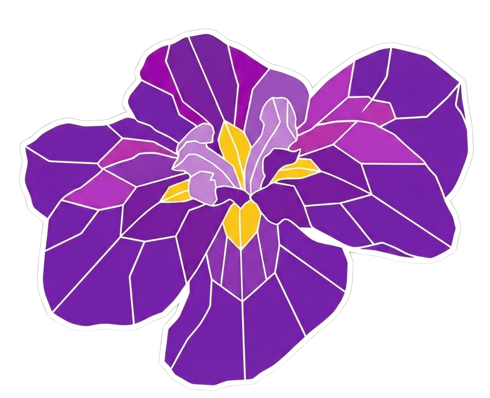
  <p><em>"Break, Fix, Repeat"</em></p>
</div>

IriSight is an autonomous vehicle built around an NVIDIA Jetson Orin Nano and
an ESP32 actuator controller. For the International stage, the team replaced
the National robot's parallel steering, unreliable depth-camera-centered
sensing and mixed rear-wheel drivetrain with a custom two-level PLA chassis,
a close-Ackermann front linkage, a LEGO differential, four matching LEGO
wheels and a Hokuyo LiDAR-centered perception system.

The complete National project remains available as a read-only engineering
baseline in [`other/legacy_national/`](other/legacy_national/). Everything at
the repository root describes the current International robot unless it is
explicitly marked as a historical comparison.

## Explore the project

| Area | Contents |
| --- | --- |
| [Source code](src/) | Jetson challenge programs, ESP32 firmware and the trained YOLO model |
| [Mechanical models](models/) | Editable STEP files, printable STL files, renders, drawings and failure evidence |
| [Electrical schemes](schemes/) | Power distribution, signal wiring, interfaces and power budget |
| [Engineering Journal](other/engineering_journal/) | Dated design decisions, iterations and assembly record |
| [Testing](other/testing/) | Repeatable test procedures, acceptance criteria and the video evidence register |
| [MATLAB modelling](matlab_simulink/) | Steering-linkage analysis and Open Challenge simulation for the MathWorks Modeling Award |
| [Vehicle photos](v-photos/) | Six standardized views of the current robot |
| [Team photos](t-photos/) | Official and informal team images |
| [Videos](video/) | YouTube demonstrations and their evidence boundary |
| [National archive](other/legacy_national/) | Complete original National Round project |

## Repository structure

```text
WRO_IriSight/
├── matlab_simulink/               MATLAB steering and Open Challenge models
├── media/                         project banner and supporting media
├── models/                        current International CAD and print files
├── other/
│   ├── engineering_journal/       development record and publication sources
│   ├── legacy_national/           complete National repository snapshot
│   └── testing/                   procedures, logs and regression evidence
├── schemes/                       current power and signal documentation
├── src/
│   ├── ai_model/                  YOLOv8n detector, results and training notes
│   ├── main_controller/           Jetson challenge programs and configuration
│   └── microcontroller/           ESP32 firmware and serial protocol
├── t-photos/                      team photos
├── v-photos/                      current vehicle photos
├── video/                         demonstration links
├── CHANGELOG.md                   National-to-International milestones
├── LICENSE.txt                    MIT License
└── README.md                      project overview
```

## Meet the team

<div align="center">
  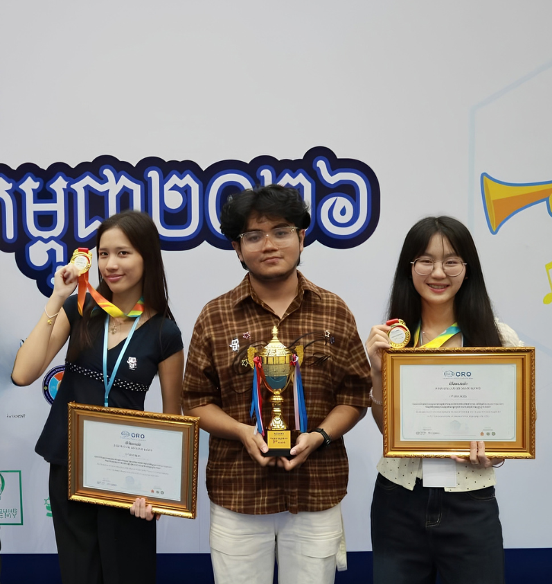
  <p><em>Team Photo - From left to right: Nita, Panha (Coach), and Muyleang.</em></p>
</div>

<table style="border: 1px solid #ccc; width: 100%; border-collapse: collapse; margin-bottom: 20px;">
  <tr>
    <td width="30%" align="center" valign="top" style="padding: 15px; border-right: 1px solid #ccc;">
      <strong>Ponlork Ponita</strong><br><br>
      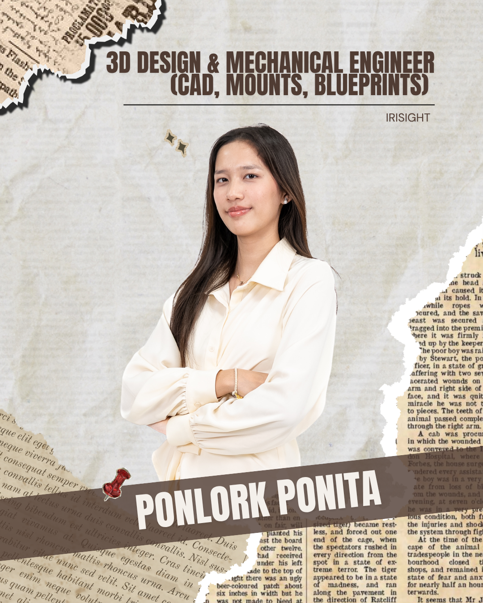
    </td>
    <td width="70%" valign="top" style="padding: 15px;">
      <strong>Role:</strong> 3D Design & Mechanical Engineer (CAD, Mounts, Blueprints)<br><br>
      <strong>Origin:</strong> Phnom Penh<br><br>
      <strong>Email:</strong> 2024352ponlork@aupp.edu.kh<br><br>
      <strong>Bio:</strong> A junior student at the American University of Phnom Penh (AUPP), she led the CAD design of the team's 3D-printed structural parts. Including the Jetson & Battery Container, the rear Motor Mount, and the RealSense Camera Mount. She carried each component through multiple print-and-test-fit iterations to achieve a LEGO-compatible, chassis-mounted final version, meticulously documenting dimensions and material properties in her blueprint sheets.
    </td>
  </tr>
</table>

<table style="border: 1px solid #ccc; width: 100%; border-collapse: collapse; margin-bottom: 20px;">
  <tr>
    <td width="70%" valign="top" style="padding: 15px; border-right: 1px solid #ccc;">
      <strong>Role:</strong> Electrical & Sensor Engineer (Wiring, Power, Sensors)<br><br>
      <strong>Origin:</strong> Phnom Penh<br><br>
      <strong>Email:</strong> 2024355taing@aupp.edu.kh<br><br>
      <strong>Bio:</strong> Serving as the hardware integration lead, she managed the vehicle's electrical infrastructure. She mapped the custom wiring schematics, engineered a stable power distribution system for the compute and motor payloads, and rigorously tested and calibrated sensor placements to guarantee accurate real-time data collection for the system's navigation stack.
    </td>
    <td width="30%" align="center" valign="top" style="padding: 15px;">
      <strong>Taing Muyleang</strong><br><br>
      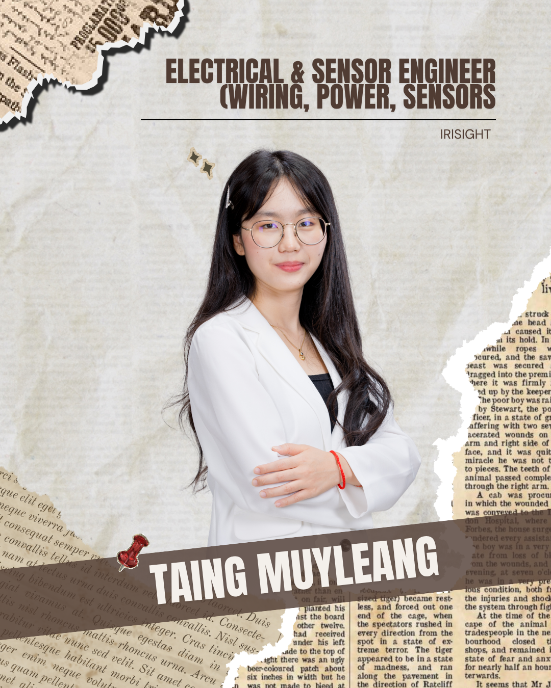
    </td>
  </tr>
</table>

<table style="border: 1px solid #ccc; width: 100%; border-collapse: collapse; margin-bottom: 20px;">
  <tr>
    <td width="30%" align="center" valign="top" style="padding: 15px; border-right: 1px solid #ccc;">
      <strong>Chamroeun Vireakpanha</strong><br><br>
      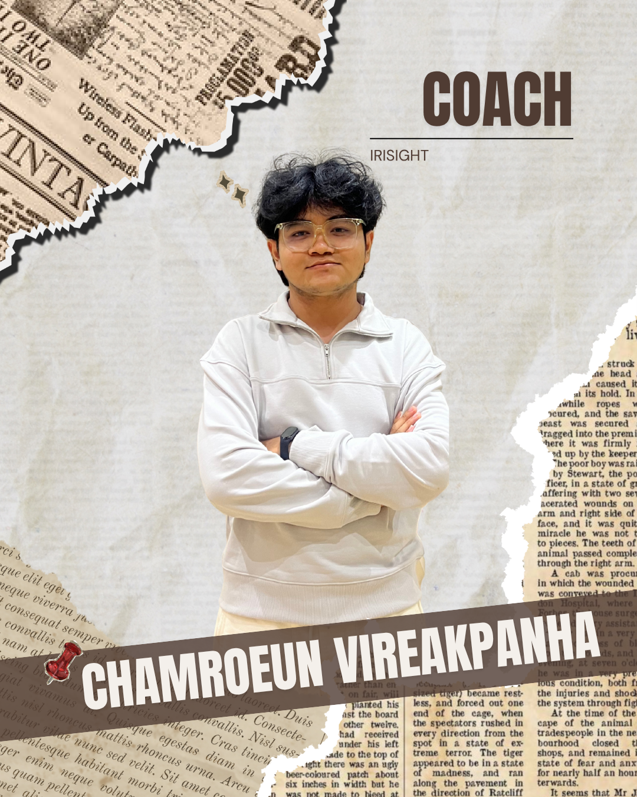
    </td>
    <td width="70%" valign="top" style="padding: 15px;">
      <strong>Role:</strong> Team Coach<br><br>
      <strong>Origin:</strong> Battambang<br><br>
      <strong>Email:</strong> 2024033chamroeun@aupp.edu.kh<br><br>
      <strong>Bio:</strong> A senior student majored in Information and Communication Technology at the American University of Phnom Penh, with experience in 3D modeling, CAD, vehicle design, and autonomous-vehicle software. In the previous season, he helped design and optimize the robot's custom parts and mechanical structure while also contributing to software, planning, coordination, and technical documentation. As IriSight's coach for the 2026 season, he uses that hands-on competition experience to guide the team through mechanical design, software development, system integration, testing, and documentation while keeping the engineering work student-led.
    </td>
  </tr>
</table>

## Current International robot

### Vehicle gallery

| 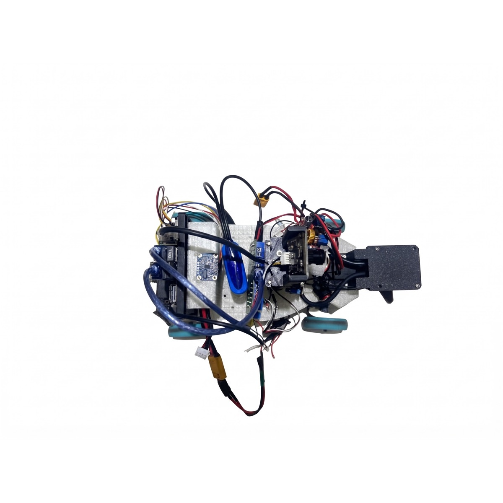 | 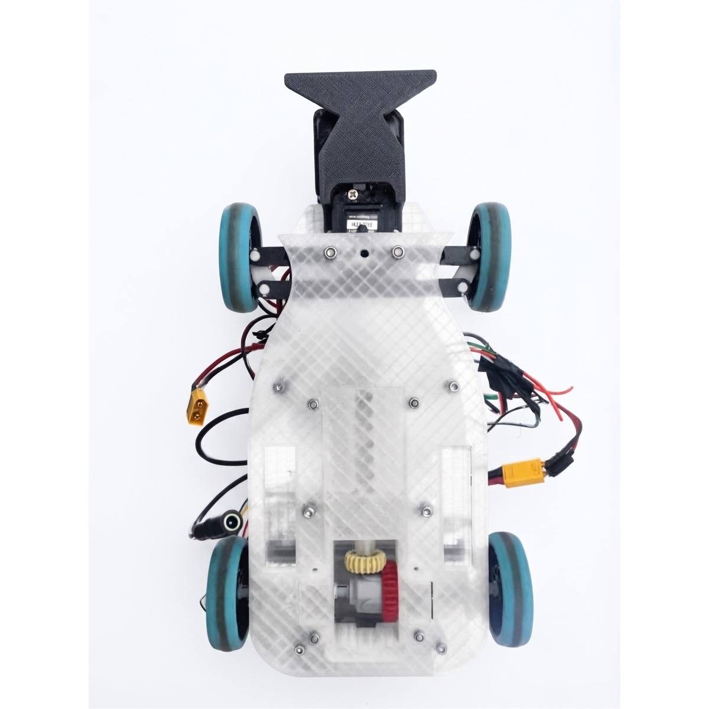 |
| :---: | :---: |
| **Top** | **Bottom** |

| 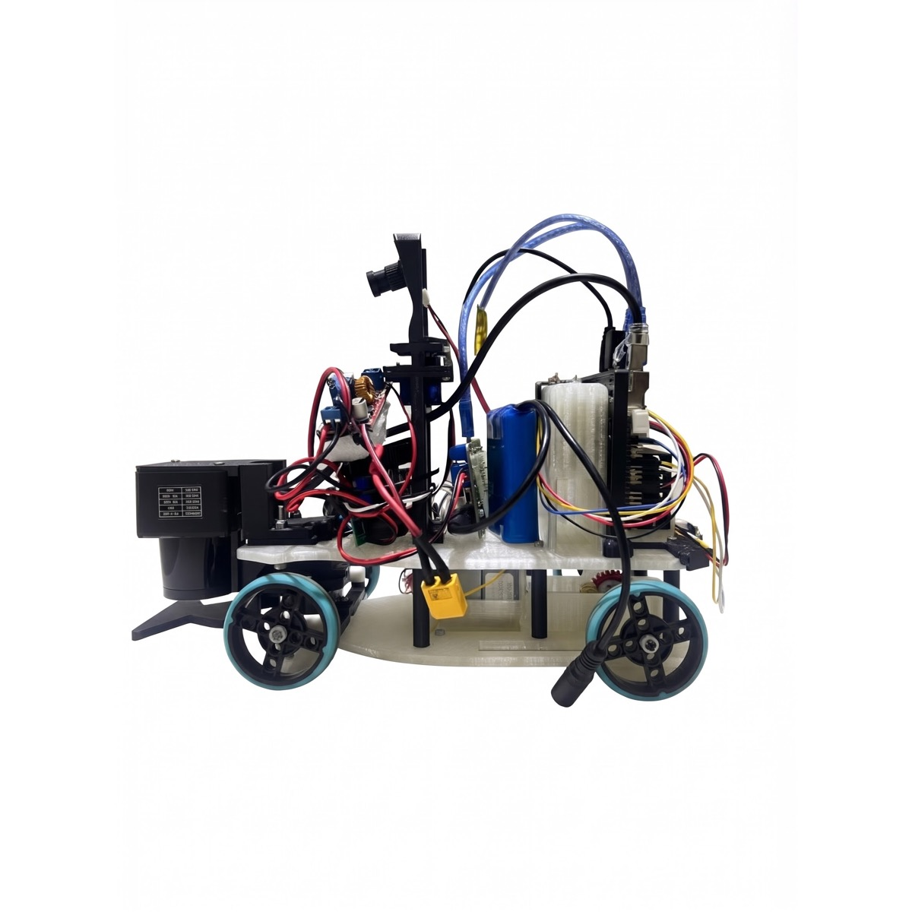 | 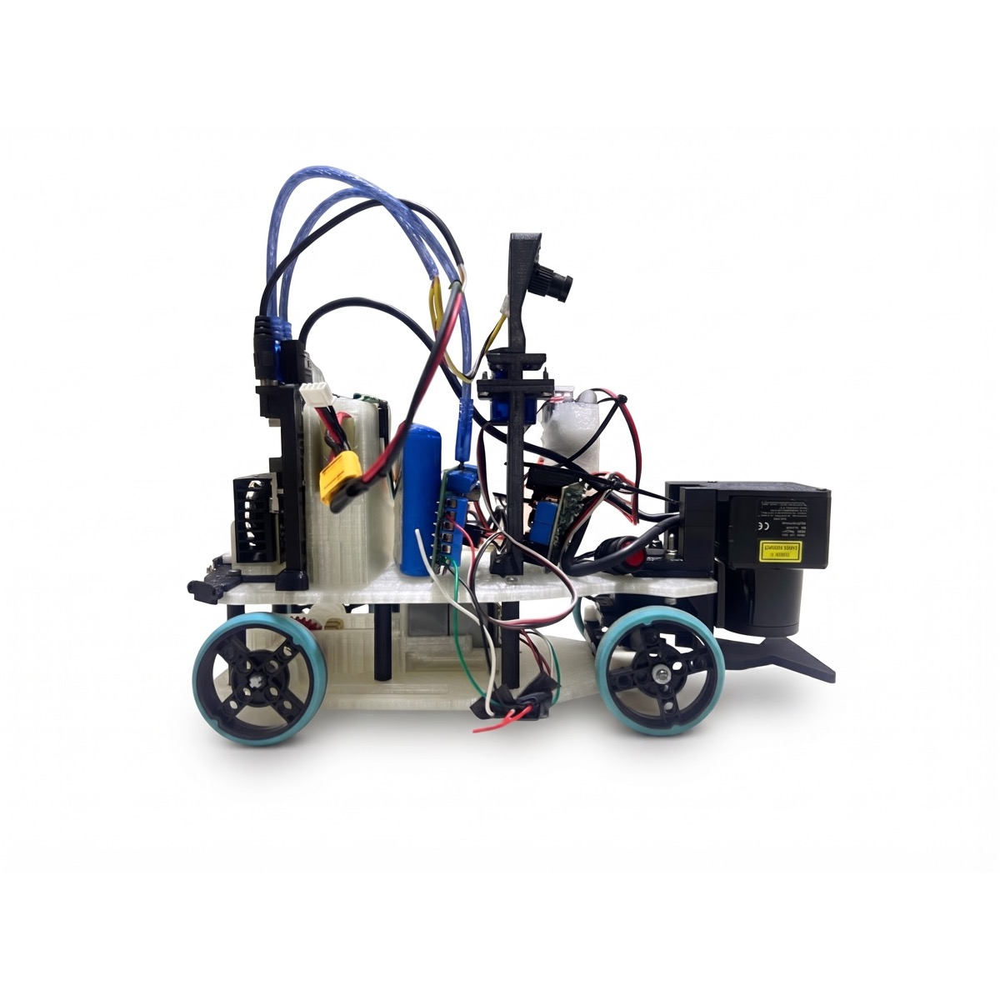 |
| :---: | :---: |
| **Left** | **Right** |

| 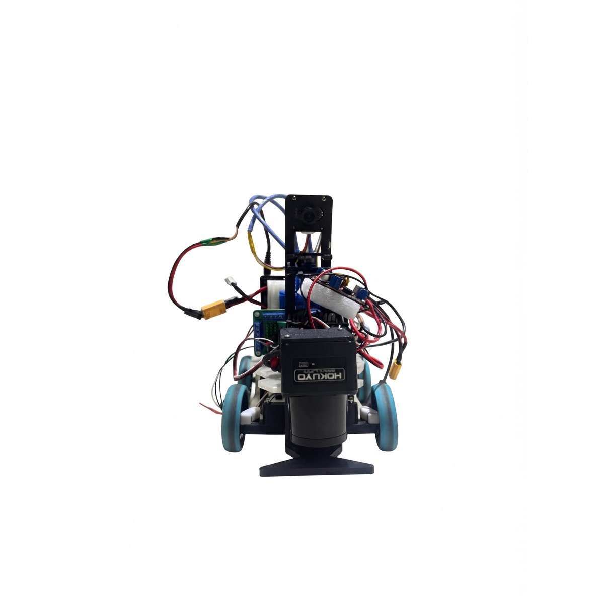 | 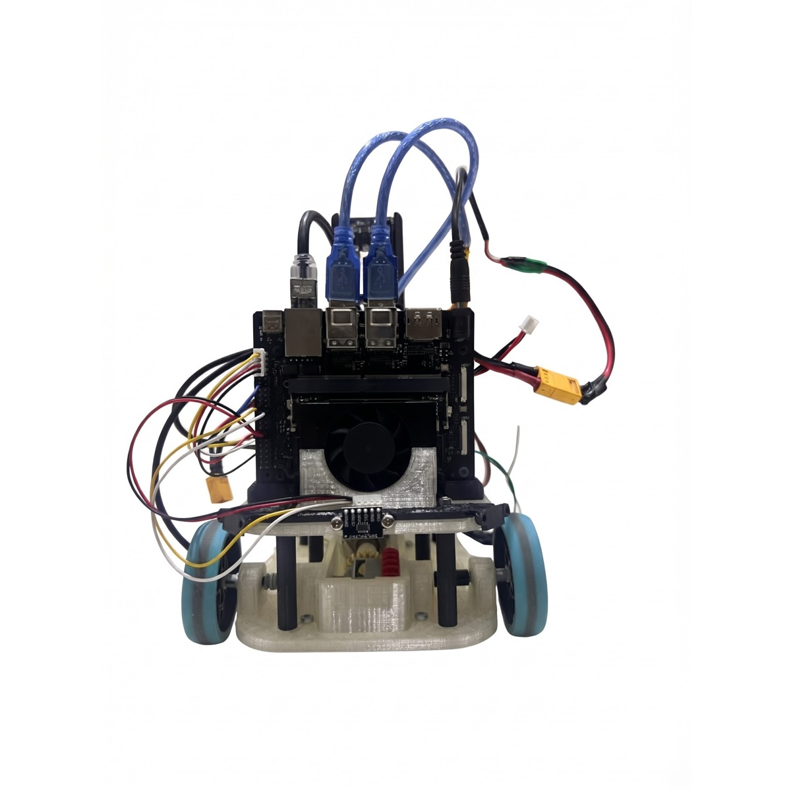 |
| :---: | :---: |
| **Front** | **Back** |

The display copies above use identical square canvases so the six required
views remain visually consistent. The uncropped source photographs are kept in
[`v-photos/robot_photo/`](v-photos/robot_photo/).

### Verified specifications

Measurements include the installed sensors and batteries.

| Property | Current robot | Rule limit | Remaining margin |
| --- | ---: | ---: | ---: |
| Length | 298 mm | 300 mm | 2 mm |
| Width | 159 mm | 200 mm | 41 mm |
| Height | 223 mm | 300 mm | 77 mm |
| Mass | 1.28 kg | 1.50 kg | 0.22 kg |

| Subsystem | Current configuration |
| --- | --- |
| Main computer | NVIDIA Jetson Orin Nano running JetPack SDK in 15 W mode |
| Microcontroller | ESP32-based controller board |
| Drive | One JGB37-520 geared DC motor, 12 V, 100 RPM |
| Rear transmission | JGB-to-LEGO coupler and one LEGO mechanical differential |
| Steering | MG996R servo and custom close-Ackermann front linkage |
| Wheels | Four LEGO 56 × 14 Technic wheels, part `39367pb01` |
| Primary ranging | Hokuyo UST-30LX 2D LiDAR |
| Vision | 1 MP Yahboom/Raspbot USB camera on a DMS-MG90-A 270° pan servo |
| Orientation | Adafruit BNO055 IMU |
| Rear distance | One rear-facing VL53L0X ToF sensor |
| Structure | Custom PLA chassis, electronics deck and subsystem mounts |
| Batteries | Two TCB 3S 1100 mAh 25C LiPo packs |

The 2 mm length margin is the most restrictive packaging constraint and drove
the cantilevered LiDAR mount design.

## National-to-International redesign

The International vehicle is a ground-up mechanical rebuild, not a cosmetic
revision of the National platform.

| Area | National robot | International robot | Engineering reason |
| --- | --- | --- | --- |
| Steering | Parallel front steering | Printed close-Ackermann linkage | Reduce tire scrub and improve the relationship between inner- and outer-wheel paths |
| Main ranging sensor | Intel RealSense D455 | Hokuyo UST-30LX 2D LiDAR | The D455 produced noisy detection on its left side; the LiDAR provides direct planar range data |
| Camera role | Depth and color perception centered on the RealSense | Small 1 MP camera for pillar classification and planned stationary mapping | Separates geometric ranging from color recognition and reduces camera dependence while driving |
| Rear motor | JGA25-370 (team recollection) | JGB37-520, 12 V, 100 RPM | More suitable drivetrain for the rebuilt platform |
| Rear transmission | Non-LEGO wheels with steel axles/gears from another kit | Custom coupler, LEGO differential and LEGO axles | Creates a replaceable, documented and mechanically integrated drivetrain |
| Wheels | Mixed front and rear wheel systems | Four matching LEGO `39367pb01` wheels | Removes the previous sticky rear-wheel behavior and standardizes wheel geometry |
| Structure | Primarily LEGO with several printed equipment mounts | Custom PLA lower chassis, six standoffs and an integrated electronics deck | Provides rigid alignment for the heavier sensor and computer package |
| Documentation | National files distributed across root subsystems | Self-contained archive under `other/legacy_national/` | Prevents historical code and hardware from being mistaken for the current robot |

The former rear wheels could remain stuck on the field below approximately
100/255 motor command even while the motor and wheels rotated normally when
the rear was lifted. Together with the sensor noise, parallel-steering limits
and shortage of reliable LEGO spares, this led the team to rebuild the robot
instead of extending the old frame.

## Mechanical design

### Rear Drivetrain Module

One JGB37-520 motor drives both rear wheels through a mechanical LEGO
differential. A custom **JGB-to-LEGO Axle Coupler** converts the motor's
D-shaped shaft to the LEGO drivetrain input. The **Integrated
Motor–Differential Mount V2** holds the motor, coupler and differential in one
aligned structure.

The first approach used separate motor and differential supports. Testing
showed vibration at the coupler, so the mounts were integrated. A later
refinement added room for another Technic bush after the right rear axle could
slide outward at high speed. Turning one unpowered rear wheel by hand makes the
other turn in the opposite direction, confirming differential action.

<div align="center">
  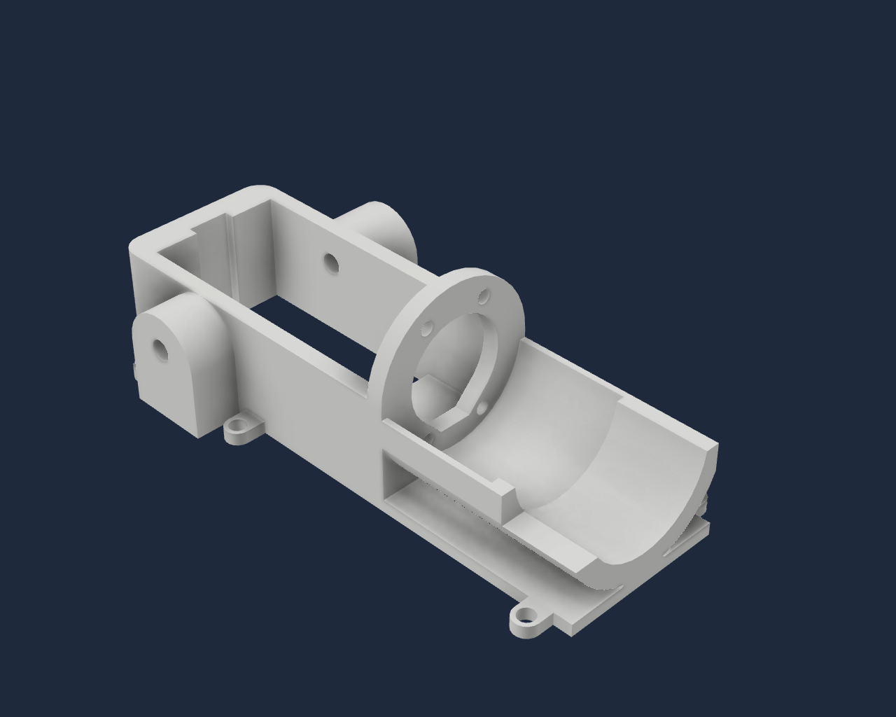
</div>

The 20-tooth motor-input gear drives the differential's 28-tooth ring gear,
adding a `28/20 = 1.40:1` reduction after the 100 RPM motor gearbox. The
estimated no-load wheel speed is therefore 71.43 RPM. With the nominal 56 mm
wheels, this corresponds to approximately `0.209 m/s`. Ideally, the same gear
pair multiplies motor-output torque by 1.40 before drivetrain losses. This
trades theoretical speed for additional wheel torque; the complete derivation
and its limitations are in the [mechanical documentation](models/#drivetrain-speed-and-torque-reasoning).

### Ackermann front steering

The front mechanism combines the **Front Steering Crossmember V2**, left and
right **Steering Knuckles V2**, **Servo-Driven Steering Link V1**, **Steering
Servo Mount** and MG996R servo. Unlike the National parallel linkage, the
steering-arm pins are inset so their projected axes approach the rear-axle
center. This creates different inner- and outer-wheel angles while turning.

<div align="center">
  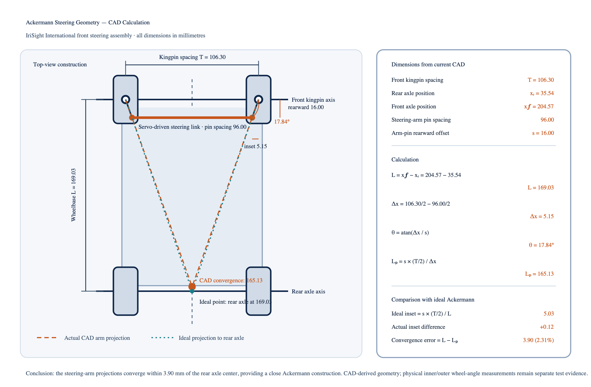
  <p><em>Ackermann geometry calculated from the current CAD. Full-resolution <a href="models/front_steering/analysis/ackermann_geometry_calculation.png">PNG</a> and editable <a href="models/front_steering/analysis/ackermann_geometry_calculation.svg">SVG</a>.</em></p>
</div>

| CAD quantity | Value |
| --- | ---: |
| Wheelbase, `L` | 169.03 mm |
| Front kingpin spacing, `T` | 106.30 mm |
| Steering-link pin spacing | 96.00 mm |
| Arm-pin rearward offset | 16.00 mm |
| Actual arm-pin inset | 5.15 mm |
| Calculated steering-arm angle | 17.84° |
| Projected convergence behind front axle | 165.13 mm |
| Offset from rear-axle center | 3.90 mm, or 2.31% of wheelbase |

For ideal Ackermann geometry, the steering-arm projections intersect the rear
axle and the wheel angles satisfy:

```text
cot(outer wheel angle) - cot(inner wheel angle) = T / L
```

For this CAD, the ideal arm-pin inset is 5.03 mm; the actual inset is 5.15 mm,
a 0.12 mm difference. We therefore describe the mechanism as a **close
Ackermann construction**. The calculation is CAD evidence. The full linkage
model in [`matlab_simulink/`](matlab_simulink/) solves the mechanism at every
steering angle and shows that it gives 56–70 % of the ideal inner–outer wheel
difference (see [Modelling with MATLAB](#modelling-with-matlab)).

Early printed pivot pins could break and later drift upward after repeated
testing. Stronger print settings reduced breakage but did not solve the drift.
Knuckles V2 use filled, extended pivots retained horizontally with M2.5
screws. The failure photograph and both revisions are preserved in
[`models/front_steering/`](models/front_steering/).

### Chassis and equipment mounting

The **Main Chassis Plate V2** carries the drivetrain and steering. Six 42 mm
**Electronics Deck Standoffs V2** connect it to the one-piece **Integrated
Electronics Mounting Deck V1**. The upper deck holds two batteries, supports
the Jetson, and provides reusable holes for sensors and test electronics.

The LiDAR is mounted at the front with a dedicated deck mount and impact guard.
The guard has already protected the sensor during contact without obstructing
its scan. A three-part camera mount stabilizes the camera pan servo while the
camera carrier alone rotates. At the rear, one platform supports the Jetson
and the rear-facing VL53L0X.

Complete part names, quantities, assembly order, STEP/STL files, drawings and
print settings are in [`models/`](models/). The dated print–test–refine story is
in the [Engineering Journal](other/engineering_journal/).

## Electrical and control architecture

<div align="center">
  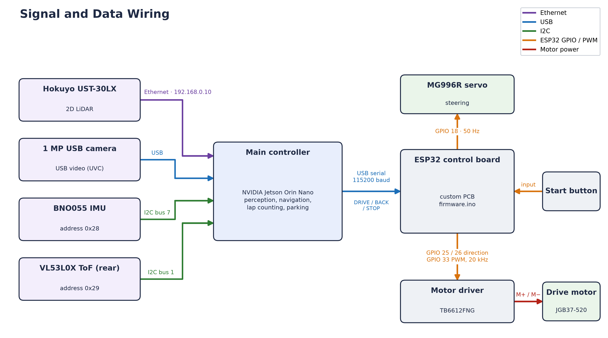
</div>

The Jetson performs perception and navigation. It reads the Hokuyo LiDAR over
Ethernet, the camera over USB, and the BNO055 and VL53L0X over I2C. It then
sends text commands over USB serial to the ESP32, which controls the rear motor
and steering servo.

| Device | Interface |
| --- | --- |
| Hokuyo UST-30LX | Ethernet, `192.168.0.10:10940` |
| ESP32 controller | USB serial, `/dev/ttyUSB0`, 115200 baud |
| 1 MP camera | Linux video device 0 |
| BNO055 IMU | I2C bus 7, address `0x28` |
| Rear VL53L0X | I2C bus 1, address `0x29` |
| MG996R steering servo | ESP32 GPIO 18 |
| TB6612FNG motor inputs | ESP32 GPIO 25, 26 and 33 |

The ESP32 accepts three newline-terminated commands:

```text
DRIVE <steering> <pwm>
BACK <steering> <pwm>
STOP
```

Two batteries isolate the computer supply from actuator current changes:

- **Battery A** connects directly to the Jetson through its barrel-power cable.
- **Battery B** supplies the control and actuator side. An XL4016 rail at
  approximately 11 V serves the ESP32/motor/LiDAR path, while an XL4015 at 5 V
  supplies the MG996R servo.

The current power diagram, signal diagram, datasheet-based power budget and
known electrical limitations are documented in [`schemes/`](schemes/).

## Software and challenge strategy

```text
LiDAR ─────────────┐
BNO055 ────────────┤
USB camera + YOLO ─┼──> Jetson navigation ──USB serial──> ESP32 ──> motor + steering
Rear VL53L0X ──────┘              │
                                  └──> testing dashboard on port 5000
```

### Open Challenge

Separate clockwise and counter-clockwise programs use LiDAR wall following,
corner detection and BNO055 heading for turn completion and lap counting.
Both directions have been tested successfully by the team. Formal trials on
the final mechanical configuration still need dated logs.

- [`open_clockwise.py`](src/main_controller/open_challenge/open_clockwise.py)
- [`open_counter_clockwise.py`](src/main_controller/open_challenge/open_counter_clockwise.py)

### Obstacle Challenge

The obstacle programs combine LiDAR geometry, BNO055 heading, YOLO pillar
classification, a direction-aware pillar map and the rear ToF sensor for final
parking. Counter-clockwise is the current calibration baseline. The clockwise
program mirrors the same direction-aware architecture; its final physical
regression results remain to be recorded. Final-parking logic exists for both
directions, with one minor counter-clockwise parking-entry refinement in
progress.

The planned perception flow is designed around the limitations of the small
camera:

1. Before driving, pan the camera to three angles while the robot is stationary.
2. Use dynamic HSV color checks together with YOLO detections to classify the
   visible pillars.
3. Fuse the three views and write a frozen JSON pillar map.
4. During the run, read that map and use LiDAR/IMU feedback for deterministic
   navigation instead of relying on continuous camera decisions while the
   robot vibrates and changes pose.

The current challenge programs consume the JSON map, but camera-servo control,
multi-view fusion and automatic JSON generation are not yet integrated. This
is the intended architecture, not a claim that the complete mapping generator
already exists.

- [`obstacle_clockwise.py`](src/main_controller/obstacle_challenge/obstacle_clockwise.py)
- [`obstacle_counter_clockwise.py`](src/main_controller/obstacle_challenge/obstacle_counter_clockwise.py)
- [Obstacle strategy and current implementation boundary](src/main_controller/obstacle_challenge/)

### AI model

The repository includes a YOLOv8n model trained to identify `greenbox`,
`redbox` and `xparking`. The stored best epoch reports precision `0.99729`,
recall `0.98508`, mAP@50 `0.99464` and mAP@50–95 `0.92769`. Training details,
all 100 epoch results and the dataset evidence boundary are in
[`src/ai_model/`](src/ai_model/).

## Modelling with MATLAB

For the MathWorks Modeling Award, [`matlab_simulink/`](matlab_simulink/)
holds MATLAB scripts that model two parts of the robot. They need only base
MATLAB (desktop or MATLAB Online), and every robot value lives in one file,
[`robot_parameters.m`](matlab_simulink/scripts/robot_parameters.m), labelled
with its source (CAD, measured, program or estimate).

- **Steering linkage.** [`steering_geometry.m`](matlab_simulink/scripts/steering_geometry.m)
  treats the knuckles and steering link as a four-bar linkage and solves it
  with `fzero` at every angle, using the CAD dimensions. The steering-arm lines
  meet 165.1 mm behind the kingpins, 97.7 % of the 169.0 mm wheelbase, so the
  textbook design rule is almost met. The full model shows that the real
  linkage still gives **56–70 % of ideal Ackermann**: the inner wheel always
  turns more than the outer wheel, but less than ideal. A hand-derived
  small-angle formula gives 56.7 %, which matches MATLAB's 55.7 % at 5°.
- **Open Challenge.** [`simulate_open_challenge.m`](matlab_simulink/scripts/simulate_open_challenge.m)
  drives a kinematic bicycle model of the robot around the WRO track, with a
  simulated 1,081-beam Hokuyo scan and a line-by-line MATLAB copy of the Open
  Challenge controller. [`sweep_open_challenge.m`](matlab_simulink/scripts/sweep_open_challenge.m)
  tries every combination of top speed and steering ratio on 1.0 m and 0.6 m
  corridors. The first runs use the estimated speed and steering ratio and
  show that the program's 2.0 s corner limit needs a top speed of about
  0.8 m/s, and that a 0.6 m corridor can end a corner early at about 60°.

The models, results, validation plan and run commands are in
[`matlab_simulink/README.md`](matlab_simulink/README.md).

## Engineering decisions, constraints and risk controls

| Constraint or observed failure | Decision and evidence | Trade-off or remaining risk |
| --- | --- | --- |
| National RealSense produced noisy readings on its left side | Separate geometry and color sensing: Hokuyo LiDAR for range, small USB camera for classification | LiDAR cannot identify color; camera calibration and a reliable cable remain important |
| National parallel steering scrubbed during turns | Build the close-Ackermann linkage documented by the CAD calculation | More printed joints and retention points than the parallel mechanism |
| Separate motor/differential supports vibrated | Integrate both supports into one mount; vibration became almost imperceptible in team testing | The combined part is larger and must be reprinted as one piece if damaged |
| Right rear axle moved outward at higher speed | Add space for another Technic bush in the 13 October mount refinement | The bush position is checked in every pre-run inspection |
| Printed steering pins broke or migrated vertically | Use solid extended pivots with transverse M2.5 retention screws | Adds screws to the printed joint; the M2.5 pivot screws are checked in every pre-run inspection |
| Complete robot length is 298 mm against a 300 mm limit | Cantilever the LiDAR mount and integrate the front guard below the scan plane | Only 2 mm margin remains, so any cable or mount change requires remeasurement |
| Camera detection became unstable while the robot vibrated and changed pose | Plan a stationary three-angle scan followed by frozen-map navigation | The scan must classify the complete field correctly before movement; incomplete maps must stop rather than guess |
| Motor and servo current changes could disturb the Jetson | Use separate controller and actuator batteries with a shared signal ground | Adds mass and wiring; no fuse is installed and converter voltages need physical remeasurement |
| Lost Jetson–ESP32 commands could leave the last motor command active | Jetson controllers issue `STOP` on faults and exit | ESP32 command timeout is not yet implemented, so link loss remains an explicit safety risk |

The detailed failure → change → retest chains are preserved in the
[Engineering Journal](other/engineering_journal/), electrical failure points
in [`schemes/`](schemes/), and repeatable acceptance procedures in
[`other/testing/`](other/testing/).

## Demonstrations and test status

| Challenge | Current evidence | Demonstration |
| --- | --- | --- |
| Open Challenge | Team-tested in both directions; formal final-configuration logs pending | [Watch on YouTube](https://youtu.be/8kb7vfMW33Q?si=mpr8wsterBccIcVb) |
| Obstacle Challenge | Counter-clockwise calibration baseline; direction-aware clockwise implementation present; final regression pending | [Watch on YouTube](https://youtu.be/Gv9RtIQvm2Q?si=-njMhDYktdj0zBOS) |

Both demonstrations are autonomous, with no manual intervention after
starting. The Open video shows three laps and an autonomous stop. The Obstacle
video shows parking exit, full-lap operation and parking entry, but not three
complete recorded laps. The footage predates the 21 November Steering Knuckles
V2 change, so it is historical proof of running rather than a final-configuration
regression record.

The final target is three consecutive successful trials for each challenge in
each direction. The procedures and acceptance criteria are in
[`other/testing/`](other/testing/); missing physical results are not filled by
assumption.

### Versioning and evidence workflow

Every formal test log records the controller, JSON configuration, firmware,
mechanical revision and Git commit used for that run. Failed tests are retained
and connected to the corrective change and retest rather than removed. Major
repository milestones are summarized in [`CHANGELOG.md`](CHANGELOG.md), while
the complete National implementation remains frozen in
[`other/legacy_national/`](other/legacy_national/) for comparison. This keeps a
judge-facing history without mixing legacy files into the current build.

## Reproducing the current system

### Software setup

1. Flash the Jetson Orin Nano with its JetPack SDK image.
2. Install NVIDIA's JetPack-compatible PyTorch build as described in
   [`src/ai_model/README.md`](src/ai_model/README.md).
3. Install the remaining Python packages:

   ```bash
   pip install -r src/main_controller/requirements.txt
   ```

4. Flash [`src/microcontroller/firmware/firmware.ino`](src/microcontroller/firmware/firmware.ino)
   to the ESP32 with the `ESP32Servo` library installed.
5. Follow the network, I2C and serial checks in
   [`src/main_controller/README.md`](src/main_controller/README.md).

### Run commands

```bash
# Open Challenge
python3 src/main_controller/open_challenge/open_clockwise.py
python3 src/main_controller/open_challenge/open_counter_clockwise.py

# Obstacle Challenge
cd src/main_controller/obstacle_challenge
python3 obstacle_clockwise.py ../config/pillar_clockwise.json
python3 obstacle_counter_clockwise.py ../config/wro_pillar_0_270_180_90.json
```

The obstacle programs expect `traffic_sign_detector.pt` in their working
directory; see the [main-controller setup](src/main_controller/README.md) for
the recommended link. Use `DRY_RUN = True` while checking decisions with the
wheels lifted.

### Competition-operation boundary

The current code is development software. Before it is described as fully
competition-ready, the team still needs to implement and physically verify:

- automatic startup without a laptop or wireless connection;
- waiting for the permitted single Start action;
- automatic three-angle pillar-map generation;
- an ESP32 command-timeout safety stop; and
- final-configuration regression trials in both directions.

These limitations are recorded so future code and testing can close them
without overstating the present implementation.

## Documentation map

| Need | Start here |
| --- | --- |
| Understand the entire International build | [Engineering Journal](other/engineering_journal/) |
| Print or edit a part | [Mechanical models](models/) |
| Wire and power the robot | [Electrical schemes](schemes/) |
| Install and run the software | [Main controller](src/main_controller/) |
| Inspect ESP32 pins and commands | [Microcontroller](src/microcontroller/) |
| Reproduce a physical test | [Testing procedures](other/testing/procedures.md) |
| Check the steering and Open Challenge models | [MATLAB modelling](matlab_simulink/) |
| Review major repository changes | [Changelog](CHANGELOG.md) |
| Inspect the former National robot | [National archive](other/legacy_national/) |

## License

The source code and documentation are released under the [MIT License](LICENSE.txt).
