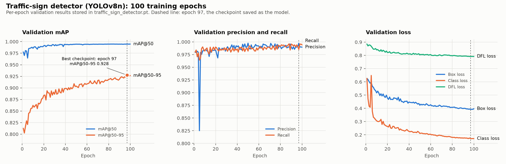

# AI model: traffic-sign detector

The robot uses one object-detection model to tell red and green traffic signs
(pillars) apart in the Obstacle Challenge. The camera only says **which colour
a pillar is and in which direction it lies**; the LiDAR measures the distance.

## What's in this folder

```text
ai_model/
├── traffic_sign_detector.pt     trained YOLOv8n model (Ultralytics checkpoint)
├── results/
│   ├── training_curves.png      validation metrics and losses for all 100 epochs
│   └── training_results.csv     the same per-epoch numbers as a table
└── photos/
    └── red_detect.png           example detection of a red pillar
```

## How it works

### The model

Every value below is read from the checkpoint file itself, except the training
date, which the team confirmed.

| Item | Value |
| --- | --- |
| Framework | Ultralytics YOLOv8, version 8.3.158 |
| Architecture | YOLOv8n (nano), started from the pretrained `yolov8n.pt` |
| Classes | 3: `greenbox`, `redbox`, `xparking` |
| Input size | 640 × 640 |
| Training | 100 epochs, batch size 8, on a CUDA GPU with mixed precision |
| Optimizer | `auto`: the stored learning-rate log peaks at 0.0014, the value Ultralytics' automatic setting gives AdamW for a 3-class model |
| Augmentation | colour jitter (hue 0.015, saturation 0.7, brightness 0.4), shift 0.1, scale 0.5, left-right flip 0.5, mosaic (turned off for the last 10 epochs), RandAugment, random erasing 0.4 |
| Training time | 8,018 s (about 2 h 14 min) |
| Saved checkpoint | epoch 97, the epoch with the best validation score |
| Trained | 25 June 2026, for the National robot |

YOLOv8n is the smallest YOLOv8 model. It was chosen so that detection runs in
real time on the Jetson Orin Nano while the LiDAR and control loops run beside it.

### Validation results

These are the checkpoint's stored validation results at epoch 97:

| Metric | Value |
| --- | ---: |
| Precision | 0.997 |
| Recall | 0.985 |
| mAP@50 | 0.995 |
| mAP@50–95 | 0.928 |
| Box loss | 0.393 |
| Class loss | 0.172 |
| DFL loss | 0.791 |



mAP@50–95 rose from 0.81 after the first epoch to 0.93. All three validation
losses reached their lowest values at epochs 97–98, so the model was still
improving slowly at the end of training rather than over-fitting. The full table is in
[`results/training_results.csv`](results/training_results.csv).

### Dataset

The labelled dataset is public on
[Roboflow Universe](https://universe.roboflow.com/damian-igwmf/wro-detection-47xs2-ahmqb),
where the project holds 5,022 images. No public dataset version is currently
generated, so the exact training, validation and test split used for the
original local training run could not be independently recovered. The dataset
was built with a semi-supervised workflow:

1. About 300 images were labelled by hand in CVAT.
2. The first trained model labelled more images automatically.
3. Those labels were checked and corrected by hand in CVAT.
4. The corrected images were added to the training set and the model was
   trained again.

Labels are YOLO bounding boxes around each pillar or parking marker.

### How the robot uses it

The two Obstacle Challenge programs in
[`../main_controller/obstacle_challenge/`](../main_controller/obstacle_challenge/)
run the model in their own camera thread:

1. The 1 MP USB camera (video device 0) delivers frames 640 px wide.
2. The model keeps detections with a confidence of at least 0.65
   (`CAMERA_CONFIDENCE`). Only `redbox` and `greenbox` are used; the current
   programs do not use `xparking`, because parking uses the rear VL53L0X.
3. The horizontal position of each box is turned into a direction relative to
   the LiDAR, using the camera's field of view (`CAMERA_FOV_DEG = 70`) and
   mounting angle (`CAMERA_YAW_OFFSET_DEG = 0`), as set in the programs.
4. When a detection lines up with a LiDAR sector, the controller treats that
   reading as a pillar, not a wall. Detections older than 0.3 s are ignored,
   and every emergency stop uses the raw LiDAR distances.

Under rule 9.19, the robot must pass a **red** pillar on its **right** and a
**green** pillar on its **left**. Which side to pass is decided from the pillar
map, as described in the Obstacle Challenge README.

The model runs unchanged on the International robot with its 1 MP USB camera.
The example photo in [`photos/red_detect.png`](photos/red_detect.png) was
recorded with the National robot's camera.

## How to use it

Install NVIDIA's JetPack build of PyTorch on the Jetson first, then
`ultralytics` without letting it replace that PyTorch build:

```bash
pip install ultralytics --no-deps
pip install opencv-python pyyaml pillow
```

Test the model on an image or a folder of images, with the same confidence as
the robot:

```bash
yolo detect predict model=traffic_sign_detector.pt source=path/to/images conf=0.65
```

Or from Python:

```python
from ultralytics import YOLO

model = YOLO("traffic_sign_detector.pt")
for box in model("test_image.jpg", conf=0.65)[0].boxes:
    label = model.names[int(box.cls[0])]       # greenbox / redbox / xparking
    print(label, round(float(box.conf[0]), 2), box.xyxy[0].tolist())
```

The obstacle programs load the model from the folder they are run in; see
[`../main_controller/obstacle_challenge/`](../main_controller/obstacle_challenge/)
for the run commands.

## Version history

| Date | File | Change | Why we changed it |
| --- | --- | --- | --- |
| 25 June 2026 | `best1.pt` | YOLOv8n trained for 100 epochs on the team's pillar dataset | Detect red and green traffic signs and the parking marker on the National robot |
| 23 November 2026 | `traffic_sign_detector.pt` | Same model, renamed; the weights are unchanged | A name that says what the model does. The National copy keeps its old name in [`other/legacy_national/`](../../other/legacy_national/) |
