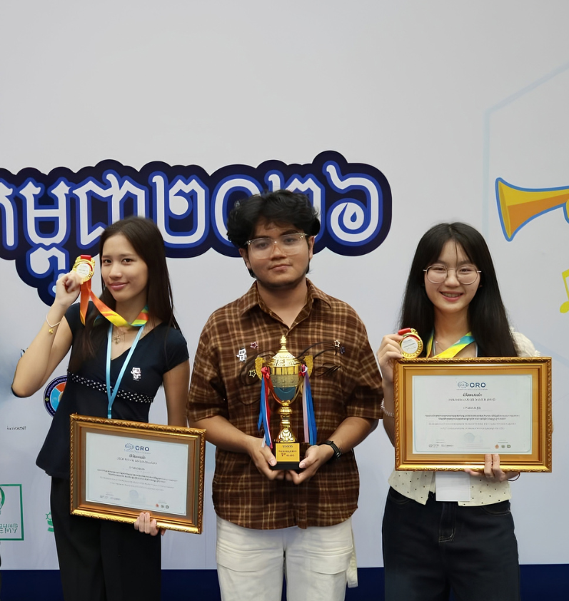
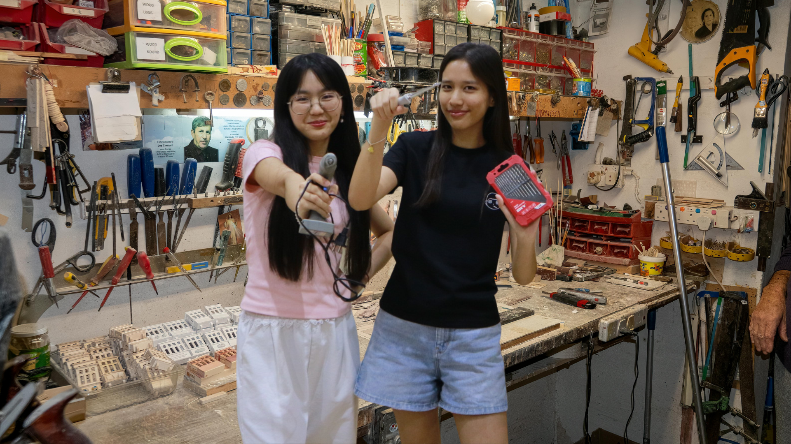

# Team photos

Official photographic documentation of Team IriSight from the American
University of Phnom Penh (AUPP).

## Official team photo

  
  
<em>From left to right: Nita, Panha (Coach), and Muyleang.</em>

## Team members

| Member | Role | Main contribution area |
| --- | --- | --- |
| [Ponlork Ponita](nita.png) | 3D Design & Mechanical Engineer | CAD, printed parts, mechanical iteration and engineering drawings |
| [Taing Muyleang](muyleang.png) | Electrical & Sensor Engineer | Power distribution, wiring, sensors and hardware integration |
| [Chamroeun Vireakpanha](panha%28coach%29.png) | Team Coach | Technical guidance, testing strategy, integration and documentation support |

The complete biographies used in the official repository overview are kept in
the root [`README.md`](../README.md#meet-the-team).

## Informal team photo

The informal photograph documents the team's collaborative work. Historical
National-stage team photographs remain in the self-contained
[`../other/legacy_national/t-photos/`](../other/legacy_national/t-photos/)
archive.
