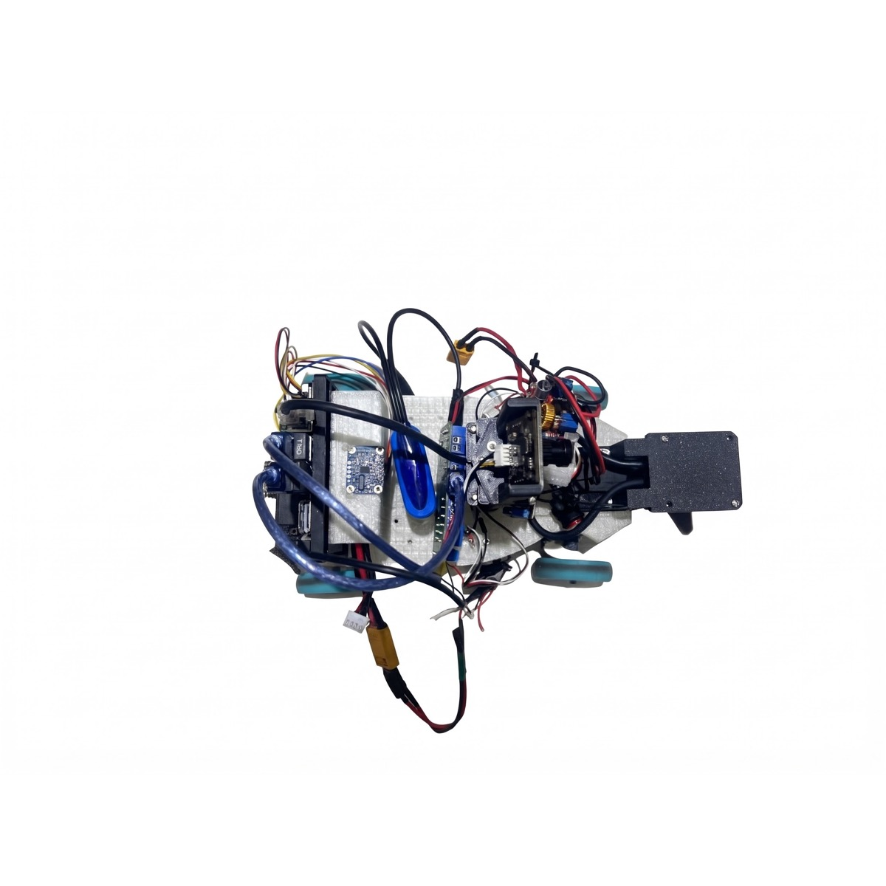
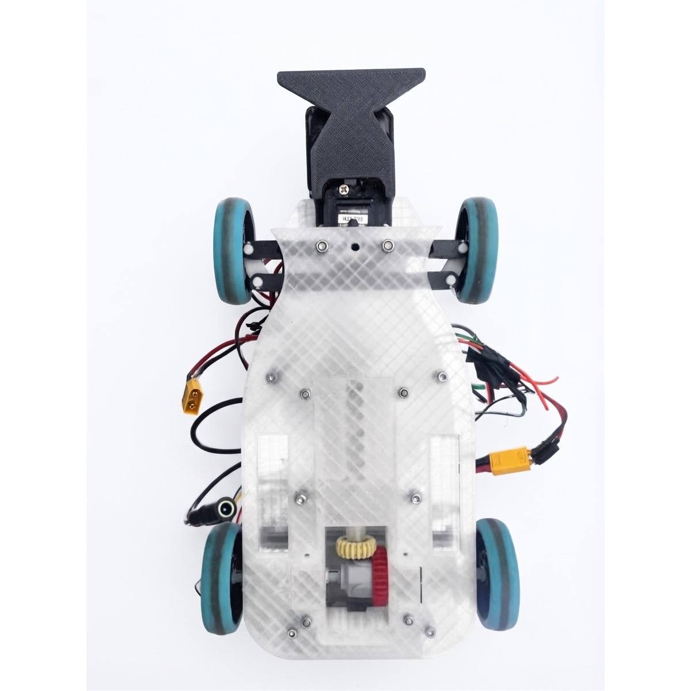
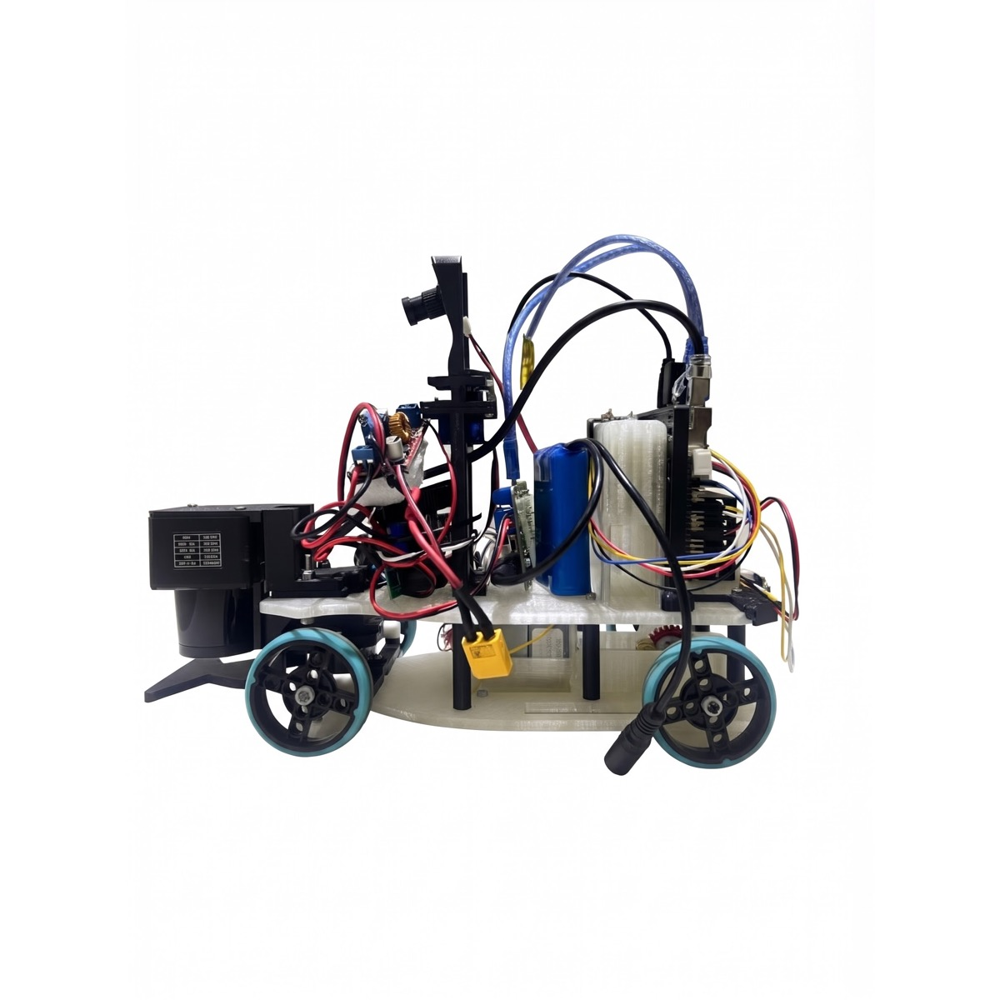
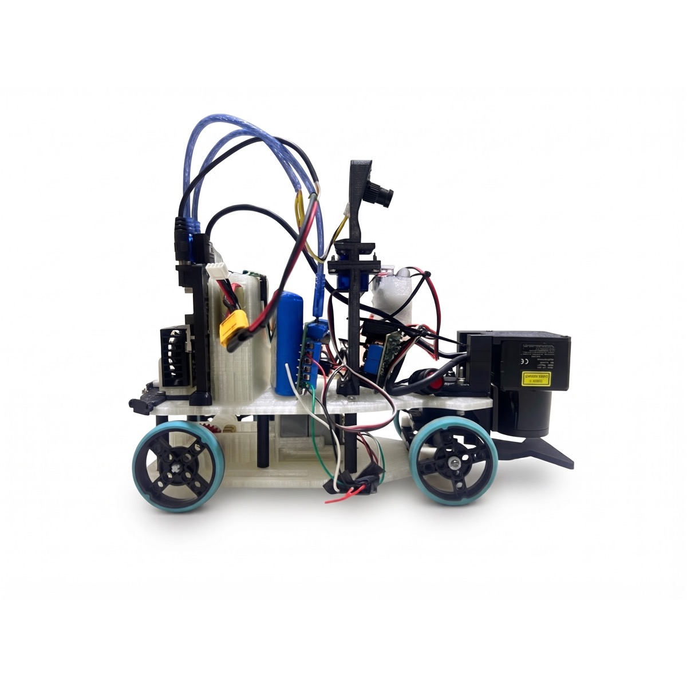
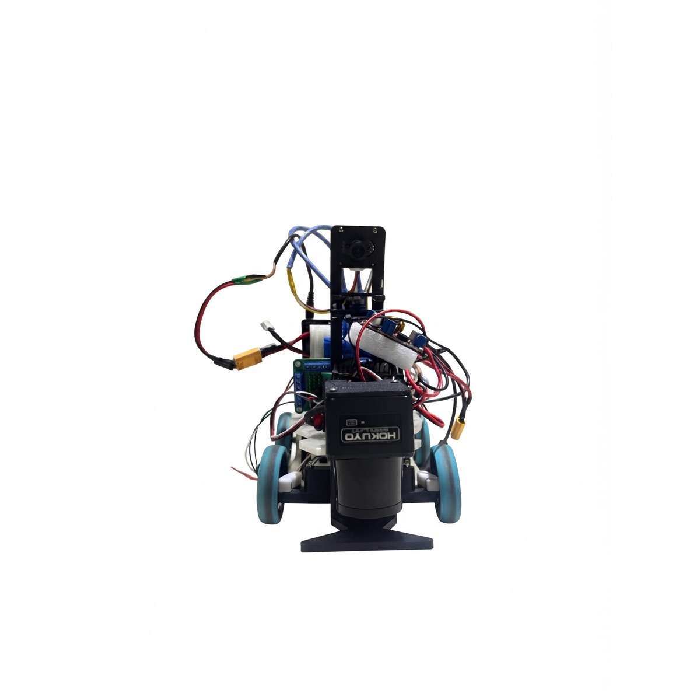
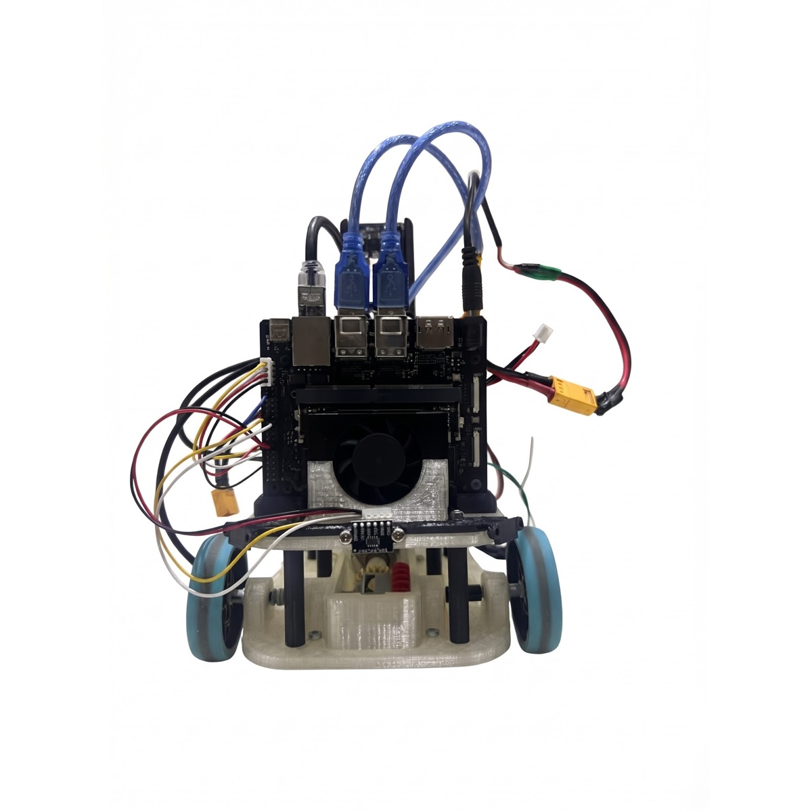

Vehicle Photos
==============

This folder contains the six required views of the current International robot. The photos show the assembled vehicle and the placement of its mechanical, sensing, computing, and power components. The gallery uses square, white-padded display copies so portrait and landscape photographs appear at the same size; the full-resolution originals remain in `robot_photo/`.

|  |  |
| :---: | :---: |
| **Top** | **Bottom** |

|  |  |
| :---: | :---: |
| **Left** | **Right** |

|  |  |
| :---: | :---: |
| **Front** | **Back** |

Photos of the National-stage robot, including its 360-degree view, are preserved in the complete [`other/legacy_national/v-photos/robot_photo/`](../other/legacy_national/v-photos/robot_photo/) repository archive.
